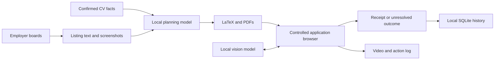

# spiral jobs

[](https://github.com/edtireli/spiral-jobs/actions/workflows/ci.yml)
[](https://github.com/edtireli/spiral-jobs/releases)
[](LICENSE)

**Your experience. Local models. Applications you can follow.**

A small macOS workspace for finding Denmark roles, preparing English documents from your actual CV, and navigating application websites with a local vision model. Watch the browser, pause when you need to, and keep a recording of each attempt.

[Download for Mac](https://github.com/edtireli/spiral-jobs/releases/latest) · [Interactive demo](https://edtireli.github.io/spiral-jobs/)

https://github.com/user-attachments/assets/4780a6d8-8639-4de4-96b4-1f714e0c8b7c

*The demonstration is a scripted simulation with fictional employers, Edis Tireli’s professional CV excerpt and placeholder contact details. It illustrates the workflow; it is not footage of an autonomous application or a model performance benchmark.*

## What it does

- **Find:** collect relevant Denmark roles from configured Greenhouse, Lever and Ashby boards when you click Find jobs, or add a listing yourself.
- **Read:** scroll through listings and retain screenshots and text beyond the first viewport.
- **Prepare:** use the CV as evidence, make small profile changes, and write a short application letter when required. Compile editable LaTeX into PDFs.
- **Navigate:** use the standard application form, with screenshots and observed controls to plan clicks, fill fields and attach PDFs. Skip LinkedIn sign-in/import and optional LinkedIn links. Keep the same session for verification after Submit.
- **Follow:** a red frame and **AI in control** badge show when automation owns the workflow. The red **AI** cursor points to the real browser targets, in the live view and recordings. Expand model output when you want more detail.
- **Submit:** choose **Review each step**, **Approve before submitting**, or **Full auto** when starting an application. Review modes hold the same browser for approval; Full auto can submit without another prompt. **Pause AI** holds the current session; **Stop** ends it. Job collection alone never submits.
- **Remember:** maintain one application per employer. Record position, location, postcode, address and deadline when listed. A submission without a receipt stays **uncertain** and blocks another attempt.

Optional Gmail access looks only for verification messages relevant to the active application, through a companion extension in your regular Chrome profile. Optional tracked project links show visits privately in the app. Neither feature is required.

## Start on a Mac

The downloadable build is for **Apple Silicon, macOS 14+**. It includes Node, Chromium, Ollama and Tectonic; model weights are downloaded separately. The current release is experimental and ad-hoc signed, **not Apple notarized**. macOS may ask you to allow the app in Privacy & Security; review the source and release checksum first. Do not disable Gatekeeper system-wide.

1. Download the release ZIP, extract it, and move **Spiral Jobs.app** into Applications.
2. Open the app. In **Profile**, paste your real CV text and contact details. Add availability, languages or work authorization under **Additional facts**, one fact per line. These saved facts become evidence for application answers. Optionally select your existing standalone LaTeX CV.
3. In **Settings → Get a model**, download a vision-capable Ollama model, or select models you already have. Choose a planning model and a vision model; they can be the same. The vision model reads listing screenshots and navigates forms; the planner matches your experience and checks answers.
4. Choose your roles, topics and Denmark locations in **Interests**. Click **Find jobs**, choose a role, and prepare the application. Review documents and answers before your first live run.

The app starts its local server and Ollama when needed, discovers a free local port, and reconnects to its own workspace. Data is stored in `~/Library/Application Support/Spiral Jobs/data`. Nothing in a fresh installation is prefilled with the author's personal information.

### Pause without losing your place

**Pause AI** is always visible while an application task is running. If a browser action, model request or compilation is already underway, the indicator says **Pausing…** until that step finishes. No subsequent fill, upload, navigation or submit action starts once the run reaches its pause point. **Resume AI** continues the same session and queue; it does not restart the application.

Pausing cannot recall a request already sent to an employer. If the final submit click happened first, resuming only checks that submission's result. **Stop** closes the browser, keeps the recording, and preserves duplicate protection for exposed or uncertain attempts. A lost dashboard connection is shown explicitly; it does not mean the run is paused.

If a model decision fails validation, the app tries one correction before pausing. **Resume same browser** retries that decision in the open session, retaining filled fields and uploaded files. Full auto can then finish under its original authorization; Final approval still waits before submitting. Stop or disable automatic applications to end the session. A closed session cannot be restored by retrying.

### Bring your models

The current backend uses the **local Ollama HTTP API**. Both model roles currently require vision support; the planner retains a screenshot fallback when a full listing capture is unavailable. Select any compatible local model; there is no account or cloud inference requirement. A smaller model generally uses less memory; evaluate its decisions on your target sites before enabling automatic submission.

- [Ollama model library](https://ollama.com/library)
- [Hugging Face GGUF models through Ollama](https://huggingface.co/docs/hub/en/ollama)
- An existing `OLLAMA_MODELS` directory, including an external disk, is discovered at launch. Downloaded models keep their own licenses.

There is no native MLX adapter in this release. An additional inference backend belongs behind `lib/runtime.mjs` and the model request functions in `lib/model.mjs` and `lib/navigator.mjs`; it must preserve evidence validation and observed-control checks.

## Boundaries that matter

This is a working prototype, not a promise of universal website automation. Some sites require human sign-in, consent or CAPTCHA completion. The app pauses when facts cannot be supported. It can describe transferable skills; it must not fabricate employers, qualifications, dates or experience. A model's explanation is not proof that an answer is correct.

Form filling and file uploads send personal data to the employer before the final submit button on some websites. Approve that exposure deliberately. Auto apply is an explicit opt-in and can submit applications without another prompt. Uncertain or partially exposed attempts must be checked with the employer before considering a retry.

Gmail uses the optional [Chrome companion](extensions/gmail/README.md), so sign-in happens in your regular browser. The app requests narrowly scoped searches for verification codes and receipts from recognized application providers. Gmail UI changes can break extraction. Codes are not sent to a model or included in the action log. There is no mail-sending function. Email links that cannot be safely completed as a code step require your attention. A verification email is never counted as a receipt. For an unresolved attempt, **Check Gmail for receipt** can reconcile an exact employer and role match without submitting again.

## Architecture



| Component | Responsibility |
| --- | --- |
| `lib/sources.mjs` | Job board adapters and Denmark filtering |
| `lib/model.mjs`, `lib/answer-evidence.mjs` | Drafts, factual grounding and answer verification |
| `lib/navigator.mjs`, `lib/navigation-service.mjs` | Observations, constrained actions, live progress |
| `lib/execution-control.mjs`, `lib/browser-control.mjs` | Pause/resume boundaries, control indicators and actual action targets |
| `lib/documents.mjs`, `templates/` | Minimal CV edits, LaTeX layouts and PDF rendering |
| `lib/store.mjs`, `lib/autonomy.mjs` | Durable history, duplicate protection and automatic runs |
| `lib/mail.mjs`, `lib/email-verification.mjs` | Isolated Gmail verification and pending form handling |
| `tracking/` | Optional hosted redirect and private visit log |
| `desktop/` | Native Mac shell, local service lifecycle and release builder |

## Develop

Use Node 24+, Python 3, [Ollama](https://ollama.com/) and [Tectonic](https://tectonic-typesetting.github.io/).

```sh
npm ci
npx playwright install chromium
npm start
```

Open the local origin printed by the server. It binds only to `127.0.0.1`. The source checkout stores private data in ignored `data/`.

```sh
npm test
npm run audit:privacy
npm run demo
```

Tests exercise controlled local fixtures, approval boundaries, evidence checks, changed attachments, one-shot submission, uncertain outcomes, form navigation, scrolling state, pause/resume before and after submission, email verification and tracking. They do not submit real applications or evaluate model accuracy across live sites. The CI badge reports the actual workflow state.

Build instructions: [desktop/BUILD.md](desktop/BUILD.md). Optional free hosted tracking: [tracking/README.md](tracking/README.md). Security and privacy: [SECURITY.md](SECURITY.md).

## Design and license

White on black, quiet typography and a moving interference field, following the visual language of [SpiralChat](https://github.com/edtireli/spiralChat). The default PDF theme echoes that style; choose Classic for a printable version.

MIT for this project. Bundled runtimes retain their original licenses and notices. Model weights are not included.
